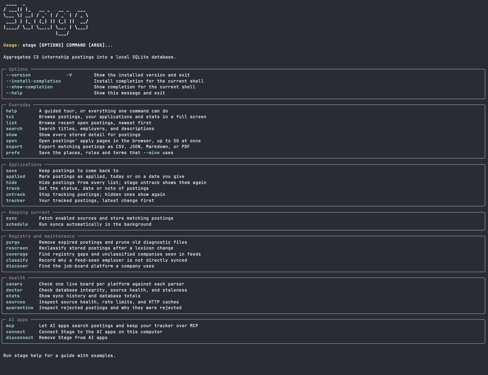
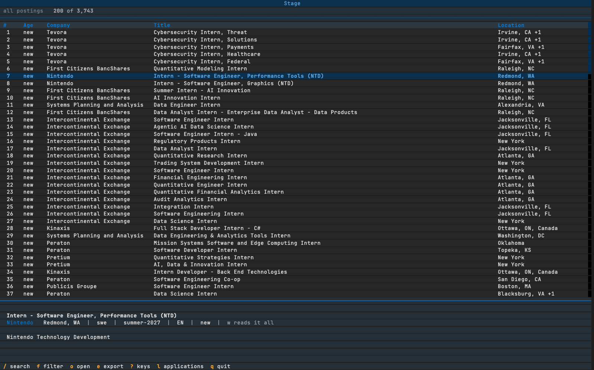
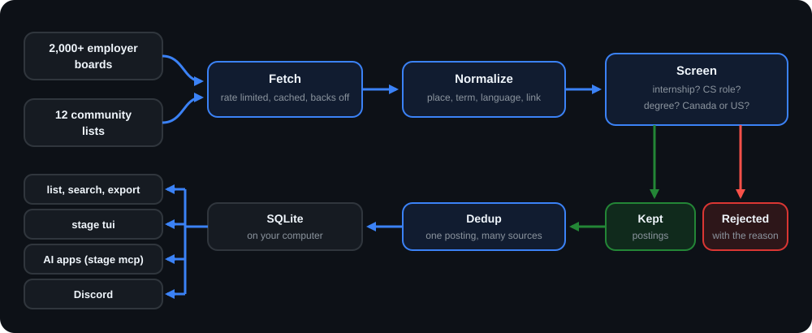
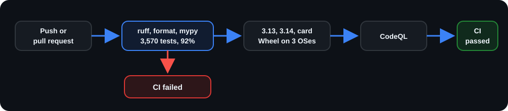

<div align="center">
<table><tr><td>
<pre>
  ____  _
 / ___|| |_   __ _   __ _   ___
 &#92;___ &#92;| __| / _&#96; | / _&#96; | / _ &#92;
  ___) | |_ | (_| || (_| ||  __/
 |____/ &#92;__| &#92;__,_| &#92;__, | &#92;___|
                    |___/
</pre>
</td></tr></table>

### One command. Thousands of internships.

**Every CS internship you can actually apply to, in one place.**

Free and open source. No account, no hosted service, no telemetry.

<br>


  [](https://github.com/NicholasXydis/Stage/actions/workflows/ci.yml)

<br>

<p align="center"><sub><b>Made with</b></sub></p>

<p align="center">
  
  &nbsp;&nbsp;&nbsp;
  
  &nbsp;&nbsp;&nbsp;
  
</p>

<p align="center"><sub><b>Works on</b></sub></p>

<p align="center">
  
  &nbsp;&nbsp;&nbsp;
  
  &nbsp;&nbsp;&nbsp;
  
</p>

</div>

## Why
Internships disappear fast. By the time you find the right posting, hundreds of students may already be ahead of you. Most job boards make it worse by burying relevant roles under senior positions, research jobs, and listings nowhere near you.

Stage scans 2,000+ employer career boards and finds internships CS undergrads in Canada and the U.S. can actually apply to. Every rejected posting is logged with the exact reason it was filtered out.

It has kept **3,877** postings out of **341,837** screened so far.

## A look at it

<div align="center">
  
  <br><sub><b>stage --help</b>: commands grouped by what you are doing</sub>
</div>

<br>

<div align="center">
  
  <br><sub><b>stage tui</b>: browse everything, filter with <b>f</b>, open with <b>o</b></sub>
</div>

## Install

```bash
uv tool install stage-cli
```

<details>
<summary><b>Don't have uv?</b> Install it first, then reopen your terminal.</summary>

<br>

If you already have Python, this works everywhere:

```bash
pip install uv
```

Or use your usual package manager: `brew install uv` on macOS, `winget install
astral-sh.uv` on Windows. More options at
[docs.astral.sh/uv](https://docs.astral.sh/uv/getting-started/installation/).

</details>

<details>
<summary><b>Other ways to install</b></summary>

<br>

```bash
pipx install stage-cli                  # isolates the tool, like uv
pip install stage-cli                   # installs into the active environment
```

`uv tool install` and `pipx` both keep Stage away from your system Python, which
is what you want for a command line tool.

</details>

Needs Python 3.12, 3.13, or 3.14. Nothing else to set up: no database to
configure, no API key, no config file.

### First run

```bash
stage sync                    # fetch every board once (grab a coffee)
stage tui                     # browse what came back
```

The first sync visits every board and takes a few minutes. Later ones are much
quicker, since Stage remembers what it already has and only asks each board for
what changed.

```bash
stage --install-completion    # tab-complete commands and filters
```

Completion needs a fresh terminal. After that, `stage <TAB>` lists commands and
`stage list --<TAB>` lists filters.

## The basics

```bash
stage sync                            # fetch the latest postings
stage list                            # what is new, newest first
stage search "machine learning"       # search titles, employers, descriptions
stage tui                             # browse it all in a full screen
```

Rows are numbered, so you can act on what you just saw:

```bash
stage list --role swe --location montreal
stage show 3                          # read the third row in full
stage open 1-5 9                      # open rows 1 to 5 and 9, then check they are up
```

Filters work the same on `list`, `search`, and `export`:

| Filter | What it takes |
| --- | --- |
| `--role` | swe, security, data, ml-ai, quant, infra, embedded, general-cs |
| `--location` | montreal, canada (the rest of Canada), usa, unknown |
| `--term` | summer-2027, fall-2026, winter-2027, and so on |
| `--lang` | en, fr, bilingual |
| `--source` | greenhouse, lever, workday, simplify, speedyapply, and more |
| `--company` | one employer, in any case |
| `--all` | every match, not just the first page |
| `--last N` | only postings first seen in the last N days. Stage keeps postings for 14 days, so this narrows the list and cannot reach further back |

Mistype one and Stage tells you what it accepts, rather than showing you an
empty list.

## The full-screen browser

```bash
stage tui
```

Press `/` to search and `f` for filters. Arrows move, enter picks, escape
closes. Your preferences, untracked only, role, location, language, how far back
to look, new-since-last-sync and the employer you are sitting on all live in that
one panel.
`space` marks rows and `o` opens every one you marked. `w` expands the full
description, `e` exports what you are looking at, and `ctrl+t` changes the theme.
Press `?` for the full key list.

Same database as the CLI. `--term` and `--source` stay CLI-only. Row
numbers are a CLI idea. In the TUI you move a cursor instead.

## Your preferences and applications

```bash
stage prefs                   # save the places, roles and terms you want
stage list --mine             # only postings that fit them
stage save 3                  # keep a posting to come back to
stage applied 1-4             # mark rows as applied today
stage hide 7                  # hide a posting from every list
stage tracker                 # everything you saved or applied to
```

`--mine` works on `list`, `search` and `export`, and every list says which
preferences it used. In the TUI, `s`, `p` and `h` save, mark applied and hide,
`z` undoes, and `l` opens your applications. Tracked postings live in their own
file, so they stay after a board takes them down.

## Keeping it fresh

```bash
stage schedule enable     # sync every 30 minutes, find new boards weekly
stage schedule status     # check on it
```

Opt-in, and it uses whatever scheduler your system already has: launchd,
systemd, or Task Scheduler. Nothing runs until you turn it on.

Each run reads only what is due, and Stage learns how often each board needs it.
Community lists are checked every time, and a new posting on one sends Stage to
that employer's own board on the next run. A board with a new internship this week,
or a company you follow, is read every hour, and the rest every one to six hours
depending on how much they post. Workable boards get a gentler three to ten hours.
A site that pushes back or slows down gets fewer
requests, and each computer starts at its own minute.
`stage schedule enable --every 6h` brings back the old pace.

Every Monday the schedule also adds the boards behind internships it kept from
the lists to your own list, `boards.yaml` in Stage's data folder. Every Wednesday
it switches off the ones that died and removes them a week later. Upgrades leave
that list alone.

Want to hear about new postings without checking? Point Stage at a Discord
channel you manage:

```bash
stage schedule notify https://discord.com/api/webhooks/...
stage schedule test-notify        # make sure it works
```

Create a Discord webhook in the channel you want Stage to post to. It is just a URL Stage uses to send new internships.

Notifications only follow scheduled syncs, not stage sync. Montreal comes first, then the rest of Canada and the US, software before other roles, and a busy run is split over up to four messages so every posting is named. Your machine also needs to be awake. If it misses runs, Stage catches up once when it can run again. Set the webhook on one machine only, because every machine that syncs on a schedule sends its own message.

<details>
<summary><b>Want notifications around the clock?</b></summary>

<br>

Put Stage on something that stays on, such as a VPS, a Raspberry Pi or an old laptop:

```bash
uv tool install stage-cli
stage sync                         # first sync, a few minutes
stage schedule notify <webhook>
stage schedule enable              # systemd, launchd, or Task Scheduler
```

That machine keeps its own database and posts to Discord on its own schedule.
Yours stays free for browsing. On a Linux server, run
`sudo loginctl enable-linger $USER` so the schedule keeps going after you log out.
`stage schedule status` says when it is needed.

</details>

## Use Stage from your AI apps

```bash
stage connect                                # pick the AI apps to connect
stage connect --status                       # see which ones are connected
stage connect claude-code --allow-actions    # also let it open, export and sync
```

Claude Code, Cursor, VS Code, Claude Desktop and about 50 other apps can then
search your postings and keep your tracker, all on your computer. Actions stay
off until you allow them, and Claude Code asks before each one. Claude Desktop,
VS Code and Goose show a search as a card, where Show all opens a table to save
or hide postings.

<details>
<summary><b>The Claude Code plugin, or one click</b></summary>

<br>

With Stage installed, the Claude Code plugin adds its tools and a skill that
teaches Claude to use them:

```text
/plugin install stage --marketplace NicholasXydis/Stage
```

Use the plugin or `stage connect claude-code`, not both.

[](https://cursor.com/install-mcp?name=Stage&config=eyJjb21tYW5kIjoidXZ4IiwiYXJncyI6WyItLWZyb20iLCJzdGFnZS1jbGkiLCJzdGFnZSIsIm1jcCJdfQ%3D%3D)
[](https://vscode.dev/redirect/mcp/install?name=Stage&config=%7B%22type%22%3A%22stdio%22%2C%22command%22%3A%22uvx%22%2C%22args%22%3A%5B%22--from%22%2C%22stage-cli%22%2C%22stage%22%2C%22mcp%22%5D%7D)

The buttons run Stage through `uvx`, so uv has to be where the app can find it.
`stage connect` is more dependable, also sets up Claude, Codex and about 50 more
apps, and takes over an entry a button made.

</details>

## Architecture

```text
Stage/
├─ src/stage/
│  ├─ cli/                  Typer commands, Rich rendering, scheduling, notify
│  ├─ tui/                  Textual screens over the same services; safe.py escapes output
│  ├─ ai/                   stage mcp: tools, prompts and answers for AI apps
│  ├─ domain/               the types every layer speaks: jobs, filters, enums, events
│  ├─ sources/              13 ATS adapters + 13 curated feeds
│  ├─ services/             sync, discover, query, export, preferences, tracker, connect, health
│  ├─ classify/             role, internship scope, degree eligibility, location
│  ├─ normalize/            location, term, language, apply-url canonicalisation
│  ├─ dedup/                cross-source duplicate resolution
│  ├─ http/                 rate posture, circuit breaker, validator cache
│  ├─ storage/              SQLite repository, migrations, FTS
│  └─ data/                 packaged registry, lexicons, font, logo, posting card
├─ tests/                   every layer, counted in the badges above
└─ .github/workflows/       CI, CodeQL, board and app canaries, release
```

<div align="center">
  
</div>

## CI

| Workflow | File | Purpose |
| --- | --- | --- |
| CI | `.github/workflows/ci.yml` | Ruff, format, mypy strict, every test, coverage floor, pip-audit, actionlint, badge drift |
| Supported Pythons | `.github/workflows/ci.yml` | The full suite again on 3.13 and 3.14, and on Windows and macOS |
| Wheel | `.github/workflows/ci.yml` | Builds and smoke-tests the wheel on Ubuntu, Windows and macOS |
| Card | `.github/workflows/ci.yml` | Renders the AI apps' posting card in Chromium against a real `stage mcp` |
| CodeQL | `.github/workflows/codeql.yml` | Static analysis for Python and the workflows themselves |
| Canary | `.github/workflows/canary.yml` | Probes one live board per platform and opens an issue on drift |
| App canary | `.github/workflows/app-canary.yml` | Connects Stage to 13 AI apps at their latest releases on all three systems |
| Release | `.github/workflows/release.yml` | Re-runs lint, types, tests, coverage and pip-audit, checks the sdist installs, then publishes from a `v*` tag |

<div align="center">
  
</div>

Any failing gate blocks the merge. The canary runs weekly and opens an issue
when a board changes shape, so parser drift surfaces before a sync does.

Every run also builds the wheel and installs it into a clean environment outside
the checkout on Ubuntu, Windows and macOS, checks the registry, lexicons and font
resolve from inside the installed package, then runs `help`, `list`, `search`,
`doctor`, `coverage`, `stats`, a dry-run sync and all four export formats against
it, checks that `stage mcp` writes nothing but JSON-RPC and serves the posting card,
and connects two AI apps in a sandbox. What ships is what gets tested.

## Good to know

- Your postings sit in one SQLite file, with your tracker and preferences in the
  same data folder. All of it is yours to open with any SQLite client, back up, or
  delete.
- The only network traffic is Stage reading public job boards, plus the Discord
  webhook if you set one. No account, no telemetry.
- Posting text reaches AI apps marked as data, with an instruction never to
  follow anything written inside it.
- Requests are rate limited per host, cached, and retried with backoff, so it
  does not hammer anyone's site.
- More than nine in ten postings arrive with no description at all. Stage marks those
  fields `unknown` instead of guessing.
- Missing something you expected? `stage quarantine` shows which rule caught it.
- Stage also reads community lists such as [Zapply's Internships](https://github.com/zapplyjobs/Internships-2027), [Canada Internships](https://github.com/zapplyjobs/Canada-Internships-2027) and [Vansh's Summer 2027 Internships](https://github.com/vanshb03/Summer2027-Internships).

## Learn more

`stage help` walks through the common workflows with real examples.
`stage help COMMAND` explains one command, and `stage --help` lists them all.

[CHANGELOG.md](CHANGELOG.md) lists what changed in each release.

## Found a bug?

Open an issue, especially if a job board stopped working, since those break
without warning and I cannot watch all of them myself. I read everything.

## Security

Stage reads public job boards and writes only on your computer: its own files, the
exports you ask for, and the app settings and schedules you ask it to change. It
never asks for credentials. AI apps reach it through `stage mcp`, or by running
`stage` where they can run commands. Found a security issue? Open a
[security advisory](https://github.com/NicholasXydis/Stage/security/advisories/new)
instead of a public issue.

## License

MIT. See [LICENSE](LICENSE).

<div align="center">
<br>
<sub>Built for students who would rather be studying than refreshing career pages.</sub>
</div>
